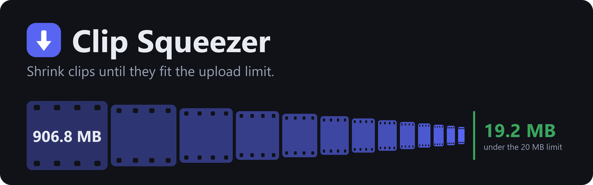
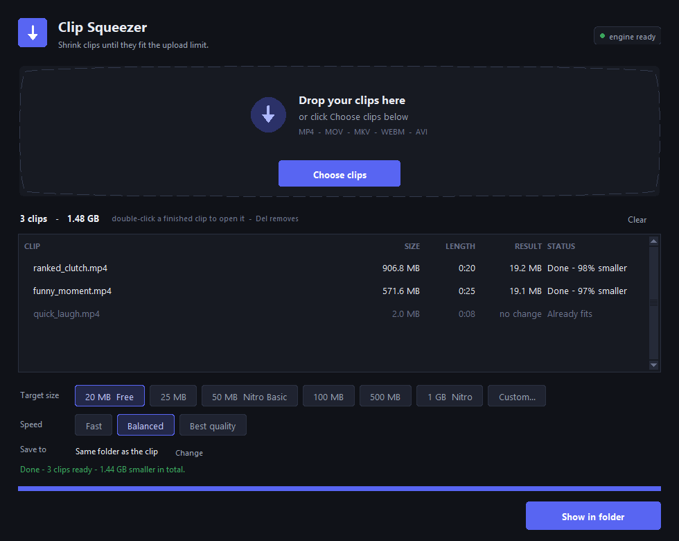

<p align="center">
  
</p>

<p align="center">
  Drag a clip in, pick a size, and get a video that actually fits.<br>
  Made for Discord. Works for any upload limit.
</p>

<p align="center">
  <a href="https://github.com/Ramitzu/clip-squeezer/releases/latest"></a>
  <a href="https://github.com/Ramitzu/clip-squeezer/actions/workflows/ci.yml"></a>
  <a href="LICENSE"></a>
</p>

<p align="center">
  <a href="https://github.com/Ramitzu/clip-squeezer/releases/latest"></a>
  &nbsp;
  <a href="https://ko-fi.com/ramitzu"></a>
</p>

<p align="center">
  
</p>

## Download

1. Get the zip from the [latest release](https://github.com/Ramitzu/clip-squeezer/releases/latest).
2. Unzip the whole folder.
3. Run `Clip Squeezer.exe`.

The first time you squeeze a clip, the app asks to download ffmpeg, the engine
that does the compressing. It's one time, about 200 MB, and after that everything
works offline.

Windows may show "Windows protected your PC" because the app isn't code-signed.
Click **More info**, then **Run anyway**.

## Features

- **Hits the size you pick.** The result lands just under your limit, or the clip is marked **Over limit**.
- **Keeps as much quality as it can.** Resolution and frame rate drop only as far as the size requires.
- **Handles batches.** Drop in several clips or a whole folder.
- **Leaves your originals alone.** Finished clips are saved next to them as `name (discord).mp4`.
- **Skips clips that already fit,** so there's no pointless quality loss.
- **Plays everywhere.** Output is H.264 and AAC in an MP4: Discord, phones, browsers, editors and VLC.
- **Stays private.** No accounts and no telemetry. The only internet use is the one-time ffmpeg download, and it asks first.

## How it hits the target

Most compressors re-encode at a fixed quality and hope. Clip Squeezer measures
the clip, works out the exact bitrate for your target, and encodes in two passes
so ffmpeg hits it.

If the result still overshoots, it retries once with a tighter budget. It only
keeps a file that is genuinely under the limit. A 60-second 1080p clip aimed at
10 MB comes out around 540p, not as 1080p mush.

## How to use

1. Drop clips on the window, click **Choose clips**, or press `Ctrl+O`.
2. Pick a target size. 20 MB is Discord's free limit.
3. Pick a speed: **Fast**, **Balanced** or **Best quality**.
4. Press **Squeeze** or `Enter`.

When the run ends, the main button becomes **Show in folder**.

| Key | Action |
| --- | --- |
| `Ctrl+O` | Add clips |
| `Enter` | Start, cancel, or show the result when done |
| `Delete` | Remove the selected clip from the list |
| `F5` | Re-read clips that failed to load |
| Double-click | Show the finished file in Explorer |

## Good to know

- **1 MB = 1,000,000 bytes**, the same way Discord counts.
- **Audio** becomes AAC at 48 to 160 kbps depending on the budget. 5.1 is folded to stereo, and only the first audio track is kept.
- **Frame rate** is capped at 60 fps, then 30 fps under about 1.5 Mbps of video, and 24 fps under about 260 kbps.
- **Rotated phone clips** stay the right way up.
- **Subtitle tracks, chapters and metadata** are removed.

## Troubleshooting

| Message | What to do |
| --- | --- |
| Over limit | The clip is too long for that size. Pick a bigger target or trim it. |
| Can't write there | Choose another save folder with **Change**. |
| This file can't be read as a video | The file is damaged or isn't a video. Try playing it first. |
| Download failed | Check your connection and press **Squeeze** again. |

The progress bar can sit low for a while on long clips. That's the first of the
two passes, and it's normal.

## Run or build from source

You need Windows and Python 3.10 or newer.

```bat
setup.bat
"Clip Squeezer.vbs"
```

`setup.bat` installs optional drag-and-drop support and fetches ffmpeg.
`run.bat` starts the app with a console so you can see errors.

Command-line mode returns a non-zero exit code if any clip fails:

```bat
py ClipSqueezer.py --cli clip.mp4 --target 20 --speed balanced --out out\
```

To build the release zip, run `build_exe.bat`. It creates `dist\Clip Squeezer\`
and `release\ClipSqueezer-v<version>-Windows.zip`.

## Contributing

Bug reports and small fixes are welcome. See [CONTRIBUTING.md](CONTRIBUTING.md).

## Support

Clip Squeezer is free. If it saved you some hassle, you can
[buy me a coffee on Ko-fi](https://ko-fi.com/ramitzu).

## Licence

Clip Squeezer's own code is under the [MIT License](LICENSE). See
[THIRD_PARTY_NOTICES.md](THIRD_PARTY_NOTICES.md) for the software it bundles or
downloads.

Clip Squeezer is not affiliated with or endorsed by Discord.
